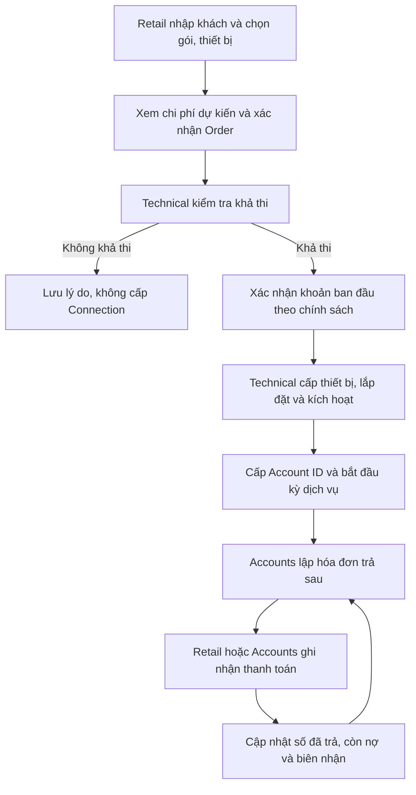

# Nexus Service Marketing System

Hệ thống quản lý tiếp thị dịch vụ, khảo sát lắp đặt hạ tầng viễn thông và thanh toán cước trực tuyến của **Nexus Communication System** (*eProject Semester 3 — FPT Aptech*), phục vụ 3 nhóm dịch vụ cốt lõi: **Broadband (`B`)**, **Landline / Telephone (`T`)** và **Dial-Up (`D`)**.

**Đối chiếu sheet công việc ngày 25/11/2026:** **11/38 đầu việc đạt, 25 một phần, 2 chưa xác minh** theo deliverable của từng dòng. [Ma trận 38 task, owner, bằng chứng và phần thiếu](docs/task-sheet-verification.md). Lượt kiểm tra này tái hiện thêm mất bill Review 1 khi migration, bill trùng kỳ, retry thu cước bị ghi thêm và public tracking lộ dư nợ trái tiêu chí sheet. Ước lượng 97%/88% chức năng [trước đó](docs/completion-review.md) chưa bao phủ các ca này, cần được rà lại sau khi đóng blocker. Các bảng kế hoạch ngày 18/11 ở mục 6 giữ nguyên để tham chiếu lịch sử.

---

## 1. Nghiệp vụ & Quy tắc cốt lõi theo đề bài

### Dịch vụ, Tiền đặt cọc & Thuế
- **Tiền đặt cọc hoàn lại (Refundable Security Deposit):**
  - **Broadband (`B`):** `$500.00`
  - **Dial-Up (`D`):** `$325.00`
  - **Landline (`T`):** `$250.00`
- **Thuế dịch vụ theo quy định:** `12.24%` tính trên tổng cước.
- **Chiết khấu đặt cọc và báo giá advance theo quy mô đường truyền (Bulk / Corporate Waivers):**
  - `10–14` đường truyền: giảm **25%** đặt cọc
  - `15–24` đường truyền: giảm **50%** đặt cọc
  - `25–50` đường truyền: giảm **75%** đặt cọc
  - `51+` đường truyền: miễn **100%** đặt cọc

**Phạm vi ưu đãi bulk theo đề gốc:** Đề ghi giảm cho khoản ứng trước (*advance*) và tiền đặt cọc (*security deposit*), không ghi giảm cước thuê bao định kỳ. Hệ thống áp ưu đãi vào cọc và báo giá advance đã được cấu hình, theo `ConnectionCount` của **cùng một Request/Order**, không cộng các đơn lịch sử của khách. Cước thuê bao, usage và phí thiết bị được tính đủ. Các khoảng `10–14`, `15–24`, `25–50`, `51+` là quy ước của nhóm để xử lý các mốc 15/25 bị chồng trong đề.

- **Advance có sổ riêng:** Đề không quy định mức tiền gốc; Admin cấu hình `advancePerConnection` tùy chọn trên gói (null = chưa có chính sách, 0 = không yêu cầu, số dương = mức/đường trước bulk). Không seed một mức tiền tự đặt. Order chốt báo giá lúc xác nhận; chỉ thực nhận mới tạo credit. Retail/Billing thu sau Feasible và trước đóng dịch vụ; Billing chủ động phân bổ vào hóa đơn mở hoặc hoàn phần chưa dùng sau đóng. Đây là chính sách triển khai của nhóm cho điểm đề còn thiếu, không thêm điều kiện kích hoạt ngoài cọc.
- **Ví dụ 10 đường Broadband BB Basic:** tiền thuê bao `225 × 10 = 2.250 USD`; cọc gốc `500 × 10 = 5.000 USD`; giảm cọc 25% = `1.250 USD`; cọc phải thu `3.750 USD`. Theo chính sách thuế hiện tại, thuế dịch vụ là `275,40 USD`, cọc thu riêng là `3.750 USD`, hóa đơn cước là `2.525,40 USD`; tổng dự toán hai khoản là `6.275,40 USD`. Các kỳ sau tiền thuê bao + thuế vẫn là `2.525,40 USD` nếu không có usage/phí/nợ cũ. Từ 51 đường truyền chỉ miễn cọc, không miễn tiền thuê bao.
- **Giả định về thuế:** Công thức hiện tại tính 12,24% trên tiền thuê bao + usage + phí thiết bị, không tính trên cọc hoàn lại hoặc nợ kết chuyển. Đề ghi “whole bill”, nên cơ sở chịu thuế của cọc vẫn cần xác nhận; sửa ưu đãi bulk không giải quyết giả định này.
- **Hóa đơn đã phát hành:** Giữ các số tiền đã lưu, không tính lại bằng chính sách bulk mới. Các trường `discountAmount`/`discountPercent` của hóa đơn cũ có thể phản ánh cách tính trước đây; giao diện gọi là **Recorded Discount** để không gán lại toàn bộ giảm giá lịch sử thành giảm cọc.

- **Danh mục gói cước chuẩn (18 gói khởi tạo mẫu):** Bao gồm đầy đủ các gói **Dial-Up (`D`)**, **Broadband (`B`)** và **Landline (`T`)** với thời hạn hiệu lực `ValidityMonths` (`1`, `3`, `6` hoặc `12` tháng), giới hạn giờ (`HoursAllowance`) hoặc băng thông (`SpeedKbps`) và đơn giá gọi Local/STD/Mobile.
  - *Lưu ý về gói `Landline STD Yearly`:* Tài liệu đặc tả gốc (`Doc 1 §Financial, p.6`) bỏ trống con số giá cước (`Yearly - $`), nên hệ thống sử dụng **`$780`** làm giá khởi tạo mặc định giả định (Admin có thể chỉnh sửa trực tiếp qua giao diện quản trị).

### Thu và hoàn cọc theo Order

Sổ `SecurityDeposits` lưu nghĩa vụ cọc chốt lúc xác nhận Order và số thực thu/đã hoàn; `DepositTransactions` lưu chứng từ, người thao tác, thời điểm, phương thức và điểm bán nếu được gán. Retail/Billing thu sau Feasible, trước Connected. Technical chỉ kích hoạt khi thu đủ hoặc được miễn cọc. Hóa đơn cước mới không cộng cọc (`includeDeposit: true` trả 400).

Retail hủy đơn chưa kích hoạt qua `POST /api/orders/{code}/cancel`; Technical chấm dứt kết nối đã kích hoạt. Billing hoàn đúng số dư thực giữ sau hủy/không khả thi/chấm dứt, có thể hoàn nhiều lần; không tự trừ nợ cước hoặc phí hỏng thiết bị. Tạm ngừng không mở quyền hoàn cọc. Đây là chính sách của nhóm cho các điểm đề chưa quy định chi tiết.

Dữ liệu cũ chỉ được nhập tiền thực thu tự động khi có đúng một hóa đơn chứa cọc đã thanh toán đủ và lịch sử payment khớp. Các trường hợp chưa rõ là `NeedsReconciliation`, chặn thu/kích hoạt/hoàn cho tới khi Billing xác minh chứng từ. Không tính tiền hoàn từ cọc lý thuyết. Hóa đơn cũ giữ nguyên các số tiền và lịch sử; gửi lại hoặc xử lý đồng thời không ghi tiền trùng.

**Luồng test chi tiết:** [Thu và hoàn tiền đặt cọc](docs/deposit-flow.md), gồm demo UI 13 bước, các nhánh hủy/miễn cọc, đối soát legacy, số tiền kỳ vọng, API, kiểm thử đồng thời và ảnh kết quả.

### Advance liên kết với Order và hóa đơn

`AdvanceAccounts` lưu báo giá theo Order và tổng thực nhận/đã phân bổ/đã hoàn; `AdvanceTransactions` lưu chứng từ. Số dư dùng được = thực nhận − đã phân bổ − đã hoàn. Miễn advance không tạo credit. Thu advance không trả cọc hoặc tự thanh toán bill. Phân bổ tạo payment kênh `Advance`, chỉ giảm nợ, không giảm tổng cước/thuế. Advance là trả trước cho chính bill tương lai nên không cộng thêm nó vào tổng dự toán cước+cọc.

Ví dụ chính sách thử 100 USD/đường, 10 đường: advance báo giá 750, thu đủ 750, phân bổ 500 vào bill 2.525,40 thì nợ còn 2.025,40 và advance còn 250. Khi chấm dứt chỉ hoàn tối đa 250 chưa dùng; cọc 3.750 xử lý riêng. Tiền đã dùng ở bill cũ không được dùng lần nữa khi chuyển kỳ. Order cũ được tạo sổ Legacy rỗng, không tự chuyển payment hoặc cọc thành advance.

**Luồng test chi tiết:** [Advance: thu, phân bổ và hoàn](docs/advance-flow.md), gồm chính sách, 14 bước UI, quyền, retry, tranh chấp đồng thời và kiểm tra trên hai database.

### Lịch sử thanh toán toàn tài khoản

Retail, Billing và Customer xem payment của tất cả hóa đơn trong Account, gồm Paid/RolledOver, không chỉ bill mới nhất. Lịch sử giữ ID gốc, bill, người ghi nhận, điểm bán đã lưu, UTC, kênh và ghi chú; có lọc/tìm/phân trang. Tổng payment toàn lịch sử tách khỏi Paid/Due của bill hiện tại và không cộng receipt/hoàn cọc hoặc advance lần nữa. `PAY-…` là mã từ ID payment đã lưu, không phải xác nhận ngân hàng. API chỉ ra bill lệch tổng payment bằng `paymentHistoryGaps`, không tự thêm tiền hoặc chứng từ giả.

**Luồng test chi tiết:** [Lịch sử thanh toán qua nhiều kỳ](docs/payment-history-flow.md), gồm số tiền ba kỳ, bốn kênh, kiểm tra quyền sở hữu, tranh chấp và ảnh UI ba vai trò. Không có mock API hoặc fallback payment trong giao diện. Chức năng CustomerPortal hiện ghi nhận payment vào DB, chưa xử lý/đối soát tiền qua cổng thanh toán thật.

**Test tích hợp bốn phần đã sửa:** [Bulk → cọc → advance → lịch sử payment → hủy/hoàn](docs/test-four-fixed-flows.md). Có luồng 10 đường qua hai kỳ, nhánh 51 đường miễn thu rồi hủy, hủy khi thu một phần và bảng phân biệt các blocker audit vẫn còn mở.

### Quy chuẩn mã định danh tự động
| Loại mã | Định dạng | Ví dụ | Thời điểm cấp |
| --- | --- | --- | --- |
| **Customer Code** | `CUS-` + `6 chữ số` | `CUS-000001` | Khi nhân viên Retail tạo hồ sơ hoặc khách hàng tự đăng ký (`/register`) |
| **Order ID** *(11 ký tự)* | `[D\|B\|T]` + `10 chữ số` | `B0000000001` | Khi quầy Retail xác nhận yêu cầu kết nối thành đơn lắp đặt |
| **Account ID** *(16 ký tự)* | `[D\|B\|T]` + `Mã vùng 3 số` + `12 chữ số` | `B101000000000001` | Khi bộ phận Technical kích hoạt kết nối (`Connected`) thành công |

### Luồng vận hành liên phòng ban
1. **Cổng công khai (`/`, `/track`, `/login` & `/register`):** Giới thiệu dịch vụ, nạp bảng giá gói cước đang hoạt động từ `/api/public/plans`, danh mục thành phố (`/api/public/cities`), tra cứu FAQ động ngay trên trang chủ (`/api/faq`), tra cứu trạng thái đơn hàng hoặc kết nối thực tế (`Active` / `TemporarilyInactive` / `PermanentlyInactive`) kèm dư nợ (`dueAmount`) bằng `Order ID` (11 ký tự) hoặc `Account ID` (16 ký tự) đảm bảo **Zero-PII** (không lộ tên/địa chỉ thuê bao), đăng nhập chung (`/login`) và **tự đăng ký tài khoản khách hàng (`/register` → `POST /api/register`)** kích hoạt ngay (`ACTIVE`) kèm phiên đăng nhập tức thì.
2. **Retail Outlet (`/retail/*`):** Tiếp nhận & cập nhật hồ sơ khách hàng, lập phiếu yêu cầu dịch vụ, xác nhận đơn sinh `Order ID` (`Pending`), ghi nhận phản hồi (`Feedback` 1–5 sao), thu cước trực tiếp tại quầy (`RetailOutlet`, hỗ trợ thanh toán từng phần `PartiallyPaid`), lưu trữ/tải lên hồ sơ chứng từ khách hàng theo năm & mã vùng, gửi yêu cầu đổi gói cước cùng loại dịch vụ và tiếp nhận/đóng câu hỏi hỗ trợ khách hàng.
3. **Technical Department (`/technical/*`):** Thẩm định khả thi kỹ thuật (khoảng cách tuyến cáp, dung lượng port server, đường dây Landline đối với gói Dial-Up → `Feasible` hoặc `Not Feasible`), kích hoạt kết nối (`Connected`) sau khi thu đủ/miễn cọc, cấp `Account ID` 16 ký tự kèm trừ tồn kho thiết bị theo `ConnectionCount`, quản lý tồn kho/sự cố hỏng hóc thiết bị, vận hành vòng đời kết nối (`Suspend`, `Reactivate`, `Terminate` mở quyền hoàn số dư cọc thực giữ) và phê duyệt/từ chối yêu cầu đổi gói cước.
4. **Billing Department (`/billing/*`):** Tra cứu `Account ID` (kèm tìm kiếm `?q=`), phát hành hóa đơn chu kỳ mới (tự động cộng phí sự cố thiết bị chưa thanh toán, kết chuyển hóa đơn cũ sang `RolledOver`, tính thuế dịch vụ 12.24%, không cộng cọc vào bill mới), ghi nhận thanh toán `CityOffice` (`PartiallyPaid`/`Paid`) và giải ngân hoàn trả tiền đặt cọc (`POST /api/deposits/{orderId}/refunds`) cho thuê bao đã chấm dứt.
5. **Admin Operations (`/admin/*`):** Quản trị danh mục gói cước (`Service Plans`), thiết bị phần cứng (`Products & Equipment` — chia sẻ quyền đọc/thêm/sửa với `Technical`, giữ quyền lưu trữ `DELETE` cho `Admin`), mã vùng thành phố 3 chữ số (`Territory Cities`), quầy bán lẻ (`Retail Shops`), nhà cung cấp (`Vendors`), đơn mua sắm & thanh toán nhà cung cấp (`Purchase Orders` / `Vendor Payments`), nhân sự và tài khoản đăng nhập (`Employees` — hỗ trợ vô hiệu hóa/kích hoạt lại tài khoản `Active = true/false`, giữ bất biến vai trò `Customer` và không gán `retailShopId`), **tạm ngưng/kích hoạt lại hồ sơ khách hàng (`SUSPENDED` / `ACTIVE`)** và tra cứu khách hàng/chứng từ/hỏi đáp.
6. **Customer Portal (`/customer` & `/customer/*`):** Cổng tự phục vụ dành riêng cho vai trò `Customer` (`/api/customer/*`): xem/cập nhật hồ sơ cá nhân (`CUS-xxxxxx`, trạng thái `ACTIVE`/`SUSPENDED`), xem gói cước và gửi yêu cầu lắp đặt mới (hỗ trợ đa đường truyền `ConnectionCount` & chiết khấu đặt cọc), theo dõi tiến độ đơn hàng & gửi đánh giá dịch vụ (1–5 sao khi đơn `Connected`), quản lý kết nối/hóa đơn và **thanh toán cước trực tuyến** toàn bộ hoặc từng phần (kênh `CustomerPortal`), gửi yêu cầu đổi gói cước cùng loại dịch vụ, gửi câu hỏi hỗ trợ và tra cứu FAQ. Dữ liệu được cô lập chặt chẽ theo chủ sở hữu (truy cập chéo trả `404`) và chặn truy cập mọi route nhân viên (`403`, bao gồm `/api/retail-shops`).

---

## 2. Kiến trúc & Công nghệ

```text
eproject-sem3-nexus-service/
├── backend/
│   ├── Nexus.slnx
│   ├── Nexus.Domain/          # Thực thể nghiệp vụ, quy tắc sinh Order ID / Account ID & vòng đời đơn
│   ├── Nexus.Application/     # Use cases, DTOs, validation & interface truy xuất dữ liệu
│   ├── Nexus.Infrastructure/  # EF Core, migrations (SQLite Demo & SQL Server), password hashing & seed
│   └── Nexus.Api/             # ASP.NET Core (.NET 10) HTTP API, Cookie Auth, CSRF & phân quyền RBAC
├── frontend/
│   ├── src/                   # Ứng dụng React 19 + TypeScript (Public, Login/Register, 4 cổng phòng ban & Customer Portal)
│   └── themes/theme-vercel/   # Gói theme tùy biến @nexus/theme-vercel trên nền Astryx Design System
└── docs/
    ├── erd.md                 # Sơ đồ thực thể liên kết (ERD) & quy tắc chuyển trạng thái đơn
    └── api.md                 # Đặc tả HTTP API contract
```

- **Backend:** `.NET 10` ASP.NET Core theo **Clean Architecture** (`Domain` ← `Application` ← `Infrastructure` / `Api`), xác thực phiên bằng `HttpOnly` Cookie kèm bảo vệ CSRF (`X-CSRF-Token`) và giới hạn tần suất đăng nhập (Rate Limiting).
- **Frontend:** `React 19`, `TypeScript`, `Vite 8`, xây dựng hoàn toàn bằng hệ thống thành phần **Astryx Design System** với giao diện sáng tối giản `@nexus/theme-vercel` (`Geist` & `Geist Mono`).

---

## 3. Hướng dẫn khởi chạy cục bộ (Quick Start)

### Yêu cầu môi trường
- **.NET 10 SDK**
- **Node.js `>= 22.13.0`** & **npm**

### Bước 1 — Chạy Backend API (Chế độ Demo SQLite tại `http://127.0.0.1:5168`)
Mở Terminal 1 tại thư mục gốc dự án:

```powershell
dotnet run --project backend/Nexus.Api -- --demo --urls http://127.0.0.1:5168
```

Với cờ `--demo`, hệ thống tự động chạy migration SQLite và khởi tạo dữ liệu mẫu vào `backend/Nexus.Api/demo.db`.
*(Để làm mới lại database demo về trạng thái ban đầu: dừng API rồi chạy `.\backend\scripts\reset-demo.ps1` — script sẽ xóa `demo.db*`, dọn dẹp tệp chứng từ tại `backend/Nexus.Api/data/documents/*` và thư mục `backend/data/smoke-*` trong khi vẫn giữ nguyên khóa phiên `backend/Nexus.Api/data/demo-keys`).*

### Bước 2 — Chạy Frontend Web App (`http://localhost:5173`)
Mở Terminal 2:

```powershell
cd frontend
npm install
npm run dev
```

Truy cập `http://localhost:5173` trên trình duyệt (Vite tự động proxy `/api` sang `http://127.0.0.1:5168`).

---

## 4. Tài khoản Demo mặc định

Mật khẩu chung cho cả 5 tài khoản mẫu (4 nhân viên phòng ban & 1 khách hàng) ở chế độ `--demo`: **`Nexus-Demo-2026!`**

| Tài khoản | Phòng ban / Vai trò (Role) | Đường dẫn mặc định | Chức năng chính |
| --- | --- | --- | --- |
| `admin.demo` | **Admin** | `/admin/plans` | Quản lý gói cước, thiết bị, mã vùng thành phố, nhân viên & danh bạ khách hàng |
| `retail.demo` | **Retail** | `/retail/customers` | Đăng ký khách hàng, tạo yêu cầu dịch vụ, xác nhận sinh `Order ID` & ghi nhận `Feedback` |
| `technical.demo` | **Technical** | `/technical/assessments` | Khảo sát khả thi kỹ thuật (`Feasible` / `Not Feasible`) & kích hoạt kết nối sinh `Account ID` |
| `billing.demo` | **Billing** | `/billing/accounts` | Tra cứu `Account ID`, lập hóa đơn cước & xác nhận thanh toán |
| `customer.demo` | **Customer** | `/customer` | Liên kết khách hàng mẫu **Trần Minh B** (`CUS-000001`): quản lý hồ sơ, gửi yêu cầu lắp đặt, theo dõi đơn/kết nối, thanh toán trực tuyến (`CustomerPortal`), đổi gói & hỏi đáp |

> **Lưu ý tự đăng ký & khóa tài khoản khách hàng:** Khách hàng tự đăng ký tại `/register` (`POST /api/register`) được kích hoạt ngay ở trạng thái `ACTIVE` và đăng nhập tức thì vào `/customer`. Khi Admin tạm ngưng hồ sơ khách hàng (`Customer.Status = "SUSPENDED"`) hoặc vô hiệu hóa tài khoản đăng nhập (`Employee.Active = false`), hệ thống từ chối đăng nhập (`403 Forbidden`) và chặn mọi thao tác ghi tự phục vụ trên `/api/customer/*` (`403 Forbidden`; riêng `Employee.Active = false` chặn cả thao tác đọc).

---

## 5. Kiểm tra Build & Triển khai SQL Server

### Kiểm tra Build & Smoke Test
```powershell
# Backend build, EF Core model check, reset demo & smoke test
dotnet build backend/Nexus.slnx
.\backend\obj\tools\dotnet-ef.exe migrations has-pending-model-changes --project backend/Nexus.Infrastructure --startup-project backend/Nexus.Api --context DemoDb
.\backend\obj\tools\dotnet-ef.exe migrations has-pending-model-changes --project backend/Nexus.Infrastructure --startup-project backend/Nexus.Api --context SqlServerDb
.\backend\scripts\reset-demo.ps1
.\backend\scripts\smoke.ps1
dotnet run --project backend/Nexus.DepositChecks
# Tùy môi trường có SQL Server LocalDB:
# dotnet run --project backend/Nexus.DepositChecks -- --sqlserver

# Frontend typecheck, production build, lint & Astryx design doctor
cd frontend
npx tsc -b --force
npm run build
npm run lint
npm test
npx @astryxdesign/cli doctor --built src --json
```

`npm test` chạy 37 ca công thức dự toán bằng Node.js, không cần cài thêm thư viện test. Smoke API dùng cùng [bộ số liệu kỳ vọng bulk](docs/fixtures/bulk-discount-cases.json) để kiểm tra 8 mốc số lượng cho cả Broadband/Dial-Up/Landline, cước thuê bao và thuế tính đủ, sổ cọc tách riêng và bảo toàn số tiền hóa đơn trước. Smoke còn chạy D01–D13 trong `backend/scripts/deposit-scenarios.ps1` và V01–V13 trong `backend/scripts/advance-scenarios.ps1`. `Nexus.DepositChecks` kiểm tra migration/legacy cọc và A00–A18 advance bằng cùng bộ ca SQLite/SQL Server LocalDB, gồm thanh toán một phần, chuyển kỳ và tranh chấp đồng thời.

### Cấu hình SQL Server (Production)
1. Thiết lập biến môi trường `ConnectionStrings__Nexus` trỏ tới SQL Server và khởi chạy API qua HTTPS **không kèm** cờ `--demo`.
2. Khi cơ sở dữ liệu chưa có nhân viên, đặt biến môi trường `NexusBootstrapPassword` (độ dài `12–128` ký tự) trong lần khởi chạy đầu tiên để tạo tài khoản quản trị `admin`, sau đó gỡ biến này khỏi môi trường chạy.
3. Xuất script migration SQL Server dạng idempotent khi cần triển khai thủ công:

```powershell
dotnet tool install dotnet-ef --tool-path .\backend\obj\tools --version 10.0.10
.\backend\obj\tools\dotnet-ef.exe migrations script --idempotent --context SqlServerDb --project backend/Nexus.Infrastructure --startup-project backend/Nexus.Api --output backend/obj/sqlserver-migration.sql
```

Hệ thống kiểm tra lịch sử mới còn chạy H01–H08 HTTP trong `backend/scripts/payment-history-scenarios.ps1` và H01–H12 EF/service trong `Nexus.DepositChecks` trên SQLite/SQL Server LocalDB. Chạy `smoke.ps1` sẽ gọi các kịch bản con; không chạy riêng từng file scenario.

### Tài liệu tham khảo nội bộ
- [Sơ đồ ERD và vòng đời đơn hàng](docs/erd.md)
- [Đặc tả API Endpoints](docs/api.md)
- [Luồng kiểm tra lịch sử thanh toán](docs/payment-history-flow.md)
- [Đánh giá lại mức độ hoàn thiện](docs/completion-review.md)
- [Verified từng đầu việc trong Google Sheets](docs/task-sheet-verification.md)

---

## 6. Review 2 — Kế hoạch hoàn thiện nghiệp vụ theo đề gốc

**Trạng thái: kế hoạch triển khai, chưa phải danh sách chức năng đã hoàn thành.** Lập ngày **18/11/2026**, dựa trên code hiện tại và hai tài liệu trong `EProject_Question.zip`: `NEXUS SERVICE MARKETING SYSTEM.doc` (nghiệp vụ) và `Project Specification - NEXUS SERVICE MARKETING SYSTEM.DOC` (đặc tả bàn giao). Chưa có ngày Review 2 cụ thể, vì vậy các chặng bên dưới được sắp theo thứ tự phụ thuộc, không cam kết ngày hoàn thành.

Các bảng hiện trạng/kế hoạch bên dưới ghi nhận mốc 18/11/2026, không phải danh sách hoàn thành hiện tại. Code đã bổ sung thuế, đặt cọc, ưu đãi và thanh toán từng phần; phạm vi ưu đãi bulk hiện hành được giải thích ở mục 1. Các ca build/smoke đạt không đồng nghĩa toàn bộ đề gốc đã được đáp ứng.

### 6.1. Mục tiêu và quyết định nghiệp vụ

- **Giữ kiểm tra khả thi.** Đề yêu cầu kiểm tra khoảng cách, server và đường dây khi cần. Review 2 dùng form đánh giá ngắn, không cần bản đồ hay hệ thống điều phối khảo sát ngoài hiện trường.
- **Giới hạn tiếp nhận theo thành phố/khu vực phục vụ**, nhưng không suy ra mọi đơn đều lắp thành công. Luôn có nhánh không khả thi kèm lý do và không được cấp kết nối.
- **Giữ dịch vụ trả sau (postpaid).** Accounts phát hành hóa đơn cước; Retail hoặc Accounts ghi nhận tiền thu. Không đổi toàn bộ hệ thống sang mua gói trả trước.
- **Cho thấy chi phí ngay sau chọn gói:** hiển thị cước tham khảo, thiết bị, đặt cọc và ưu đãi dự kiến. Có thể thu khoản ban đầu theo chính sách được chốt, nhưng không coi đó là hóa đơn cước sử dụng hoặc xác nhận đã kích hoạt.
- **Giữ đủ bốn vai trò** Admin, Retail, Technical, Billing/Accounts. Không cần thêm hệ thống kế toán sổ cái, định khoản Nợ/Có hay tính lương.
- Tất cả thay đổi trạng thái, phát hành bill, thu/hoàn tiền và xuất/nhập kho phải có người thực hiện, thời điểm và lịch sử kiểm tra lại được.

### 6.2. Hiện trạng và phần cần thay đổi

| Phân hệ | Hiện tại | Mục tiêu Review 2 | Ưu tiên |
| --- | --- | --- | --- |
| Khách hàng và Request/Order | Tạo/sửa/tìm khách, tạo request, xác nhận order | Giữ luồng; lưu cố định giá, chu kỳ, địa chỉ và lựa chọn thiết bị tại lúc xác nhận | P0 |
| Khảo sát và kích hoạt | Có `Pending → Feasible/NotFeasible → Connected` | Tinh gọn form; bổ sung điều kiện cấp thiết bị/đặt cọc theo chính sách đã chốt | P0 |
| Gói cước | Một giá đơn giản; ba gói seed | Quản lý chu kỳ, giới hạn giờ/tốc độ, đơn giá sử dụng và ngày hiệu lực; seed các gói có thông tin rõ trong đề | P0 |
| Bảng giá công khai | Dữ liệu tĩnh phía frontend | Đọc danh mục active qua API công khai chỉ trả trường cho phép; đồng bộ với Admin | P0 |
| Billing | Một bản ghi cho mỗi connection | Nhiều hóa đơn theo kỳ, dòng phí, thuế, ngày đến hạn, lịch sử và số còn nợ | P0 |
| Payment | Chỉ Billing đánh dấu đã trả toàn phần | Retail và Billing ghi nhận từng lần thu, trả một phần/toàn phần, phương thức và biên nhận | P0 |
| Đặt cọc và ưu đãi | Mới mô tả trên trang chủ | Sổ đặt cọc/ứng trước riêng, giảm theo nhóm đăng ký, hoàn tiền có lịch sử | P0 |
| Trạng thái thuê bao | Mới có kích hoạt | Active, tạm ngừng, kích hoạt lại, ngừng vĩnh viễn; tách khỏi trạng thái đơn/thanh toán | P0 |
| Tra cứu | Chủ yếu theo mã, bộ lọc hạn chế | Tìm theo mã/tên/điện thoại/loại dịch vụ/khoảng ngày; phân trang phía server | P1 |
| Thiết bị và tồn kho | Danh mục Product độc lập | Nhập kho, giữ chỗ/xuất cho kết nối, thu hồi, thay thế, chống âm kho | P1 |
| Vendor và mua hàng | Chưa có luồng | Danh mục vendor, đơn mua, nhận hàng, ghi nhận khoản trả vendor ở mức cơ bản | P1 |
| Retail và nhân sự | Có vai trò, chưa quản lý điểm bán | Điểm bán theo thành phố; gắn nhân viên, đơn và nơi thu tiền với điểm bán | P1 |
| Khách tự xem thông tin | Chỉ tracking công khai không lộ PII | Cổng có xác thực cho khách xem thông tin, kết nối, bill và khoản thanh toán của mình | P1 |
| Hồ sơ và chứng từ | Chưa có quản lý hồ sơ | Lưu hồ sơ đăng ký, giấy tờ, biên nhận theo khách/đơn; có phân quyền tải xuống | P1 |
| Kiểm thử và bàn giao | Có smoke test API; chưa có script `npm test` | Bổ sung kiểm thử nghiệp vụ và E2E phù hợp, diễn tập UI, cập nhật tài liệu và backup | P0 |

**P0:** phải qua trước khi chốt luồng demo chính. **P1:** hoàn thiện độ bao phủ đề gốc sau khi P0 ổn định, vẫn là mục tiêu Review 2. Nếu thiếu thời gian, ghi rõ hạng mục P1 còn mở và trao đổi phạm vi với giảng viên; không tự coi đó là yêu cầu được miễn.

### 6.3. Luồng nghiệp vụ đích



Luồng đặt cọc mặc định đề xuất là thu sau khi xác nhận khả thi, trước khi kích hoạt. Nếu thu ngay sau chọn gói, phải tạo Order/tham chiếu khoản thu trước, lưu chính sách và xử lý hoàn khi đơn bị từ chối hoặc hủy. **Thời điểm thu là đề xuất của nhóm, chưa phải quy định rõ trong đề gốc.** Màn hình dự toán trước xác nhận không được tạo khoản phải thu ngoài ý muốn.

Tách trạng thái thành các nhóm độc lập:

| Đối tượng | Trạng thái dự kiến | Quy tắc |
| --- | --- | --- |
| Order | `Pending`, `Feasible`, `NotFeasible`, `Connected`, bổ sung `Cancelled` | Chỉ Technical đánh giá/kích hoạt; đơn không khả thi hoặc đã hủy không được kết nối |
| Connection | `Active`, `TemporarilyInactive`, `PermanentlyInactive` | Tạm ngừng có thể khôi phục; ngừng vĩnh viễn không tự khôi phục khi có payment |
| Invoice | `Draft`, `Issued`, `PartiallyPaid`, `Paid`, `Voided` | Draft chưa phải nợ; hóa đơn đã phát hành không sửa âm thầm; quá hạn tính từ due date và số còn nợ |
| Payment | `Recorded`, `Reversed` | Ghi nhận sau khi kiểm tra bằng chứng; đảo giao dịch bằng bản ghi có lý do, không xóa lịch sử |
| Đặt cọc | Chưa thu, đã thu, hoàn một phần, đã hoàn | Không tính đặt cọc là cước dịch vụ hoặc tự động cấn trừ bill |

Đã thanh toán không đồng nghĩa đã lắp xong. Ngày bắt đầu sử dụng/chu kỳ cước gắn với kích hoạt; quy tắc kỳ lẻ và ngày phát hành bill phải được chốt trước khi lập trình phần tính cước.

### 6.4. Thay đổi và nâng cấp phần lõi

#### A. Gói cước và báo giá

- [ ] Mở rộng Plan: loại dịch vụ, nhóm Hourly/Unlimited/Local/STD, thời hạn, giá thuê bao, giới hạn giờ/tốc độ và đơn giá cuộc gọi khi áp dụng.
- [ ] Lưu phiên bản hoặc snapshot giá/chu kỳ/thuế/ưu đãi/thiết bị khi xác nhận; Admin đổi danh mục không làm thay đổi đơn cũ hoặc bill đã phát hành.
- [ ] Tách chu kỳ thu cước khỏi thời hạn/quota của gói; không suy diễn gói 10 giờ là trả trước khi đề quy định dịch vụ postpaid.
- [ ] Hiển thị chi phí dự kiến ngay sau chọn gói, nêu rõ khoản ban đầu và khoản cước sẽ lập bill theo kỳ.
- [ ] Bảng giá trang chủ và danh sách Retail lấy từ cùng danh mục backend; giữ nguyên snapshot lịch sử khi archive gói.

#### B. Hóa đơn, thuế và công nợ

- [ ] Thay quan hệ một `BillingRecord`/Connection bằng một Connection có nhiều Invoice theo kỳ; mỗi Invoice có các dòng phí, subtotal, discount, taxable amount, tax, total, issuedAt và dueAt.
- [ ] Accounts nhập dữ liệu sử dụng hoặc import dữ liệu mẫu có kiểm tra: giờ Internet, phút local/STD, số đơn vị messaging và phí thiết bị/thay thế. Review 2 chưa cần tích hợp hệ thống đo cước thực tế.
- [ ] Chặn phát hành trùng cùng Account ID/kỳ/loại hóa đơn; kiểm tra dữ liệu sử dụng thuộc đúng kỳ và không âm.
- [ ] Dùng decimal, quy định làm tròn USD hai chữ số; lưu thuế suất và số thuế trên hóa đơn, không chỉ tính trên frontend.
- [ ] Mô hình tính dự kiến: `Cước kỳ = phí thuê bao + phí sử dụng + phí thiết bị + phí khác được duyệt`; áp ưu đãi hợp lệ, xác định phần chịu thuế rồi tính thuế `12.24%`. Cơ sở chịu thuế của đặt cọc/ứng trước phải chốt riêng.
- [ ] Hiển thị `Còn nợ hóa đơn = Tổng hóa đơn - Tổng khoản thu hợp lệ đã phân bổ - Khoản điều chỉnh giảm hợp lệ`; nợ kỳ cũ hiển thị riêng, không bị đưa vào doanh thu và tính thuế lại ở kỳ mới.
- [ ] Cho phép Accounts phát hành bill bằng thao tác thủ công theo kỳ để demo; có thể bổ sung lịch tự động sau khi quy tắc đã ổn định.

#### C. Thu tiền, đặt cọc và ưu đãi nhóm

- [ ] Mỗi Payment có mã tham chiếu duy nhất, số tiền, thời điểm, người thu, điểm thu và phương thức; phân bổ tiền vào hóa đơn cụ thể.
- [ ] Retail được xem bill và ghi nhận payment; Billing được lập bill và ghi nhận payment tại văn phòng. Backend kiểm tra quyền, không chỉ ẩn nút.
- [ ] Hỗ trợ trả một phần/nhiều lần; không tự đánh dấu Paid khi còn nợ. Mặc định chặn phân bổ vượt số còn nợ, trừ khi đã xây sổ tín dụng/ứng trước riêng.
- [ ] Chống nhấp/gửi lại tạo trùng khoản thu bằng khóa idempotency hoặc mã giao dịch; xử lý hai nhân viên cùng thu trên một hóa đơn.
- [ ] Sổ đặt cọc/ứng trước liên kết Order để có thể thu trước Account ID; khi kích hoạt mới liên kết thêm Connection, không tạo Account ID giả.
- [ ] Áp số tiền đặt cọc cơ bản D/B/T là `325/500/250 USD`; lưu mức giảm và số tiền thực thu theo nhóm đăng ký.
- [ ] Ưu đãi số lượng phải có nhóm/hợp đồng và số đường truyền xác định; không tự cộng mọi đơn lịch sử của cùng khách. Đề đề cập giảm cả ứng trước và đặt cọc; không tự giảm cước hàng kỳ.
- [ ] Hoàn đặt cọc khi kết thúc/hủy theo chính sách được duyệt; lưu khoản hoàn và lý do, kiểm tra không hoàn vượt số dư. Không tự khấu trừ nợ nếu chưa có chính sách.

#### D. Technical và vòng đời thuê bao

- [ ] Giữ form khảo sát ngắn và kiểm tra Dial-Up có/không có landline Nexus; lưu kết quả và lý do từ chối.
- [ ] Khi kích hoạt, kiểm tra trạng thái order, khả dụng thiết bị và chính sách khoản ban đầu; cấp Account ID đúng một lần trong giao dịch nhất quán.
- [ ] Thêm thao tác tạm ngừng, khôi phục và ngừng vĩnh viễn; ghi người thực hiện, thời điểm hiệu lực, lý do và lịch sử.
- [ ] Hiển thị nợ/quá hạn cho người có quyền, nhưng chưa tự cắt mạng khi chưa chốt quy tắc thời gian ân hạn và khôi phục.
- [ ] Giữ feedback sau khi đã được cung cấp kết nối; hiển thị riêng trạng thái đơn và trạng thái thuê bao trên các màn tra cứu.

### 6.5. Bổ sung quản lý vận hành và cổng khách hàng

- [ ] **Retail outlet:** danh mục điểm bán, thành phố, địa chỉ và liên hệ; liên kết nhân viên/Order/khoản thu với điểm bán, xác định phạm vi dữ liệu mỗi nhân viên được xem.
- [ ] **Vendor:** tên, liên hệ, sản phẩm cung cấp; danh sách đơn mua, giá trị, khoản đã trả/còn phải trả vendor ở mức theo dõi cơ bản.
- [ ] **Kho và mua hàng:** Purchase Order → nhận hàng → nhập kho; xuất/giữ chỗ theo đơn, gắn thiết bị với Connection; không tăng kho khi đơn mua chưa nhận hàng.
- [ ] **Cấp phát/thay thế:** lưu thiết bị, số lượng hoặc serial, ngày cấp/thu hồi, người thao tác và phí thay thế nếu có; tách hoàn hàng khỏi hoàn tiền.
- [ ] **Tra cứu nâng cao:** kết hợp mã, tên, điện thoại, loại dịch vụ, trạng thái, thành phố và khoảng ngày; hỗ trợ phân trang server thay vì chỉ lấy tối đa 100 bản ghi rồi chia trang phía client.
- [ ] **Cổng khách có xác thực:** xem thông tin, đơn/kết nối, hóa đơn và lịch sử trả tiền của chính mình; kiểm tra quyền sở hữu từng API để không đọc dữ liệu khách khác.
- [ ] **Tracking công khai:** tiếp tục chỉ trả trạng thái và mã tham chiếu; không đưa bill, số nợ hoặc PII lên API công khai khi chưa xác thực.
- [ ] **Yêu cầu từ khách:** do đề vừa nhắc khách đặt đơn vừa quy định chỉ Retail được tạo Order, phương án đề xuất là khách gửi yêu cầu, Retail tiếp nhận/xác nhận thành Order. Xác nhận cách diễn giải này trước khi triển khai.
- [ ] **Hồ sơ:** lưu file mẫu đơn, giấy tờ và chứng từ theo khách/đơn/năm/khu vực; kiểm tra loại/kích thước file, quyền đọc và nơi lưu ngoài thư mục public. Dùng dữ liệu giả khi demo.

### 6.6. Thiết kế dữ liệu, API và chuyển đổi dữ liệu

Tên thực thể/endpoint cụ thể sẽ chốt khi viết ERD/API; đây là hướng thiết kế, không phải API đã tồn tại.

| Nhóm | Thay đổi dự kiến |
| --- | --- |
| Danh mục | Plan/PlanVersion, tariff rates, RetailOutlet, Vendor, thông tin thiết bị và giá liên quan |
| Đơn và thuê bao | Snapshot giá/chu kỳ/địa chỉ/thiết bị, nhóm đăng ký bulk, ConnectionStatus và lịch sử chuyển trạng thái |
| Tài chính khách | Invoice, InvoiceLine, Payment, PaymentAllocation, Deposit/Advance ledger, Refund/Reversal |
| Vận hành | PurchaseOrder/Line, GoodsReceipt, StockMovement, EquipmentAssignment, VendorPayment |
| Khách và hồ sơ | CustomerIdentity, quan hệ sở hữu, CustomerDocument và metadata chứng từ |
| Audit | Người thao tác, vai trò/điểm bán, thời điểm UTC, lý do, tham chiếu và khóa chống trùng |

- [ ] Giữ nguyên Customer Code, Order ID, Account ID đã cấp và quan hệ hiện có; không reset database đang dùng để né migration.
- [ ] Viết migration cho cả SQLite demo và SQL Server; backup trước khi chạy và thử trên bản sao có dữ liệu Review 1.
- [ ] Chuyển bill cũ thành hóa đơn legacy với nguyên Amount/PaidAt và khoản thanh toán tương ứng nếu đã Paid; không hồi tố tự cộng thuế, đặt cọc hoặc khoản nợ chưa từng ghi nhận.
- [ ] Với dữ liệu cũ không có snapshot lịch sử đầy đủ, đánh dấu legacy/nguồn suy diễn; không giả định giá danh mục hôm nay là giá lịch sử chính xác.
- [ ] Bổ sung API list hóa đơn/payment và tổng công nợ từ backend. Các màn Payments/Registry không phụ thuộc danh sách vừa tra lưu trong bộ nhớ frontend.
- [ ] Ràng buộc unique/FK, transaction và kiểm soát cập nhật đồng thời cho lập bill, thu tiền, hoàn tiền, xuất kho và kích hoạt.
- [ ] Cập nhật `docs/erd.md`, `docs/api.md`, DTO và frontend trong cùng chặng; tránh FE/BE sử dụng hợp đồng khác nhau.

### 6.7. Ma trận quyền mục tiêu

| Thao tác | Admin | Retail | Technical | Billing/Accounts | Khách có xác thực |
| --- | --- | --- | --- | --- | --- |
| Quản lý gói, vendor, điểm bán, nhân sự | Có | Không | Không | Không | Không |
| Hồ sơ khách và tiếp nhận Order | Tra cứu/quản lý theo quyền hiện có | Có, trong phạm vi được giao | Chỉ phần cần cho công việc | Chỉ phần cần cho lập bill/thu tiền | Xem của mình; gửi yêu cầu |
| Khảo sát, kích hoạt, đổi trạng thái kết nối | Không mặc định | Xem trạng thái | Có | Xem trạng thái | Xem của mình |
| Phát hành/điều chỉnh hóa đơn | Không mặc định | Xem | Không | Có | Xem của mình |
| Ghi nhận payment/thu đặt cọc | Không mặc định | Có | Không | Có | Xem khoản đã xác nhận |
| Mua/nhập thiết bị | Có | Không | Xem theo nhu cầu | Xem phần cần đối soát | Không |
| Cấp phát/thu hồi thiết bị | Quản lý danh mục và kiểm tra kho | Xem thông tin cần thiết | Có, có audit | Xem phí liên quan | Xem thiết bị của mình |

Quyền hoàn tiền, đảo giao dịch và duyệt mua hàng phải được chốt riêng, không mặc định Admin có thể thực hiện mọi nghiệp vụ. Nếu chưa có vai trò duyệt riêng, đề xuất Billing ghi nhận hoàn/đảo tiền và Admin duyệt theo chính sách nhóm thống nhất.

### 6.8. Phần tinh gọn, bỏ và để giai đoạn sau

**Tinh gọn trong Review 2:**

- Giữ một form khảo sát với kết quả/lý do; chưa làm GPS, bản đồ kéo cáp, tối ưu tuyến hoặc lịch điều phối kỹ thuật.
- Thay bảng giá hardcode bằng API, gom công thức tính tiền và validation quan trọng về backend.
- Thay thao tác chỉ đổi cờ Paid bằng giao dịch thu tiền có số tiền/chứng từ; thay danh sách tài chính chỉ lưu tạm ở frontend bằng dữ liệu server.
- Không đổi tên dự án thành hệ thống bán gói trả trước hoặc bỏ vai trò Technical/Billing.

**Để sau Review 2, trừ khi giảng viên yêu cầu:**

- Tích hợp cổng thanh toán thật, webhook, đối soát ngân hàng tự động; trước mắt dùng ghi nhận thu thủ công có chứng từ.
- Kế toán tổng hợp, sổ cái, bảng lương và báo cáo tài chính doanh nghiệp.
- Hệ thống đo lưu lượng/CDR thật, tự tính cước theo thời gian thực; trước mắt nhập/import usage có kiểm tra.
- Tự động cắt/khôi phục dịch vụ, thông báo SMS/email, dashboard phân tích nâng cao.

Các phần kho, vendor, Retail, bill trả sau và trạng thái thuê bao vẫn thuộc yêu cầu gốc; không xếp chúng thành tùy chọn chỉ vì chưa có trong Review 1.

### 6.9. Những giả định cần chốt trước khi tính tiền

| Điểm chưa rõ trong đề | Cách xử lý trong kế hoạch |
| --- | --- |
| Ngưỡng 10–15, 15–25, 25–50 bị chồng biên | Đề xuất 10–14: 25%; 15–24: 50%; 25–50: 75%; 51+: 100%. Đây là giả định ở mục 1, cần xác nhận và test tại các biên |
| Ưu đãi áp cho ứng trước và đặt cọc; không nêu số tiền ứng trước | Đã tách sổ; mức advance do Admin cấu hình, mặc định null, snapshot theo Order. Chính sách nhóm: trả trước tùy chọn, phân bổ vào bill, hoàn phần chưa dùng; xem [advance-flow.md](docs/advance-flow.md) |
| Gói Landline STD yearly thiếu giá | Để Draft/Unavailable đến khi có giá xác nhận; không seed giá 0 hoặc tự bịa giá |
| Gói STD Half-Yearly ghi thời hạn một tháng | Đánh dấu mâu thuẫn, xác nhận thời hạn trước khi cho đăng ký |
| Thuế ghi trên toàn bill, chưa làm rõ đặt cọc hoàn lại | Chốt khoản chịu thuế, thời điểm ghi nhận và cách hoàn; không tự coi đặt cọc chắc chắn chịu/không chịu thuế |
| Chưa rõ ngày chốt kỳ, kỳ lẻ, quota và cước vượt giờ | Ghi chính sách kỳ cước/usage cụ thể, ngày hiệu lực, mẫu tính và kỳ vọng trước khi lập trình |
| Chưa rõ số lượng bulk được tính theo khách hay hợp đồng | Đề xuất nhóm đăng ký/hợp đồng với số đường truyền đã xác nhận; chốt xử lý hủy bớt đường truyền |
| Chưa rõ ngừng dịch vụ, hoàn đặt cọc và xử lý nợ | Chốt ngày dừng tính cước, khoản phải trả/hoàn, điều kiện duyệt; giữ lịch sử và số dư |
| Khách đặt đơn và quy định chỉ Retail được đặt Order | Đề xuất yêu cầu từ khách → Retail xác nhận; chưa cho khách gọi API tạo Order nội bộ |

Các điểm cần xác nhận không chặn việc thiết kế schema, hoàn thiện phân quyền, danh mục và UI. Tuy nhiên không dùng giả định chưa duyệt để phát hành hóa đơn thật hoặc tuyên bố đã đáp ứng đầy đủ đề.

### 6.10. Thứ tự triển khai và đầu ra từng chặng

| Chặng | Việc thực hiện | Đầu ra và điều kiện qua chặng |
| --- | --- | --- |
| 1. Chốt phạm vi | Đối chiếu yêu cầu, chốt giả định ở 6.9, phân công người phụ trách BE/FE/QA và ngày review | Danh sách phạm vi, công thức có ví dụ và tiêu chí pass/fail được thống nhất |
| 2. Dữ liệu nền | Snapshot, phiên bản gói, trạng thái Connection, Invoice/Payment/Deposit, Retail/Vendor/Kho; thiết kế quyền | ERD/API thống nhất; migration chạy trên DB sạch và bản sao Review 1; dữ liệu cũ còn nguyên |
| 3. Luồng P0 backend | Khảo sát/kích hoạt, định kỳ hóa đơn, thuế, ưu đãi, thu/hoàn tiền, quyền Retail/Billing | Kiểm thử tính tiền, sai trạng thái, chống trùng và cập nhật đồng thời đạt |
| 4. Luồng P0 frontend | Dự toán ngay sau chọn gói; chi tiết đơn/thuê bao; hóa đơn, payment, đặt cọc và công nợ | Chạy trọn luồng Broadband/Dial-Up bằng UI, refresh vẫn đúng; không phụ thuộc dữ liệu hardcode |
| 5. Bao phủ P1 | Vendor, mua/nhập/xuất thiết bị, Retail, tra cứu nâng cao, cổng khách, hồ sơ | Một chuỗi nhập kho → cấp thiết bị → bill/thu tiền và một ca khách xem đúng dữ liệu của mình |
| 6. Ổn định và bàn giao | Regression, SQL Server, dependency, tài liệu, backup và diễn tập | Checklist 6.11 đạt; lỗi còn mở có mức độ/người xử lý; gói demo và tài liệu tái lập được |

FE có thể dựng màn bằng hợp đồng API đã chốt trong khi BE làm nghiệp vụ; QA chuẩn bị dữ liệu và test cùng chặng. Không phát triển lại thiết kế giao diện toàn bộ khi luồng P0 chưa ổn định.

### 6.11. Checklist kiểm thử và nghiệm thu Review 2

**Nghiệp vụ và số tiền**

- [ ] Broadband: tạo khách → xác nhận đơn → Feasible → thu khoản ban đầu theo chính sách → cấp thiết bị → Connected → có Account ID.
- [ ] Dial-Up: có landline chỉ kiểm tra Internet; chưa có landline phải kiểm tra thêm đường dây. Không khả thi cần lý do và bị chặn kích hoạt.
- [ ] Landline: lập bill có tiền thuê bao và usage đúng loại local/STD/messaging theo gói đã xác nhận.
- [ ] Kiểm tra ngưỡng bulk tại 9, 10, 14, 15, 24, 25, 50, 51 đường truyền theo chính sách cuối cùng; không giảm nhầm cước hàng kỳ.
- [ ] Mẫu tính độc lập: cước chịu thuế 225.00 USD, không usage/phí/discount khác → thuế 27.54 USD → tổng 252.54 USD. Bản ghi legacy 225.00 USD không bị tự chuyển thành 252.54 USD.
- [ ] Thanh toán 100.00 USD trên bill 252.54 USD → còn 152.54 USD, trạng thái PartiallyPaid; thu tiếp 152.54 USD → Paid. Nợ này không bị tính thuế lần nữa ở kỳ sau.
- [ ] Gửi lại phát hành cùng kỳ/thu tiền/kích hoạt không tạo trùng; kiểm tra cả hai thao tác đồng thời.
- [ ] Admin đổi giá gói sau xác nhận đơn không làm đổi snapshot đơn hoặc hóa đơn đã phát hành.
- [ ] Tạm ngừng/khôi phục/ngừng vĩnh viễn đúng quyền và có lịch sử; hoàn đặt cọc không vượt số dư, đảo payment cập nhật lại số còn nợ.

**Dữ liệu, quyền và trải nghiệm**

- [ ] Retail thu tiền được nhưng không lập/sửa bill; Technical không thu tiền; khách không đọc bill/hồ sơ người khác bằng cách thay ID.
- [ ] Tracking công khai vẫn tra được Order/Account, không lộ PII hoặc công nợ; thông tin tài chính chỉ xuất hiện sau xác thực.
- [ ] Nhập kho chỉ tăng khi nhận hàng; hai người cấp cùng thiết bị không làm âm kho hoặc cấp trùng serial.
- [ ] Refresh/đăng nhập lại vẫn đọc được bill, payment và lịch sử từ DB; tra cứu được dữ liệu ngoài 100 bản ghi đầu tiên.
- [ ] UI có loading, empty/error state, validation, khóa thao tác khi đang gửi; mất kết nối không hiển thị thu tiền/kích hoạt thành công giả.
- [ ] Upload trái loại/quá dung lượng hoặc tải chứng từ không đúng quyền bị chặn.
- [ ] Build FE/BE, lint, smoke và E2E trọng điểm đạt; cập nhật script test thực sự tồn tại thay vì ghi `npm test` khi chưa khai báo.
- [ ] Migration/luồng chính được chạy trên SQL Server, không chỉ xuất script; SQLite demo và dữ liệu legacy đều được kiểm tra.
- [ ] Rà soát cảnh báo dependency hiện có, nâng phiên bản phù hợp rồi chạy regression; ghi rõ vấn đề còn mở, không chạy auto-fix phá tương thích thiếu kiểm tra.

**Kịch bản trình bày đề xuất 12–15 phút**

1. Admin giới thiệu gói có chu kỳ/giá, điểm bán, vendor và một phiếu nhập thiết bị.
2. Retail tạo khách và đơn Broadband, cho xem dự toán ngay sau chọn gói và mã Order.
3. Technical xác nhận khả thi; Retail/Billing ghi nhận đặt cọc theo chính sách; Technical cấp thiết bị và kích hoạt, chép Account ID.
4. Accounts nhập usage mẫu nếu có, lập bill kỳ đầu; Retail thu một phần, Billing thu phần còn lại, chỉ rõ số nợ thay đổi và biên nhận.
5. Tải lại, tra Account ID và bill kỳ khác để chứng minh dữ liệu bền vững và nhiều hóa đơn/kết nối.
6. Minh họa nhánh Dial-Up không khả thi; tạm ngừng/khôi phục một thuê bao và một thao tác sai quyền bị chặn.
7. Khách đăng nhập xem bill của mình; đăng xuất và tra công khai để chứng minh không lộ thông tin riêng.

Không tự đổi ngày hệ thống để demo kỳ cước; dùng kỳ demo/usage seed và lưu rõ thời gian trên bản ghi.

### 6.12. Tài liệu và điều kiện chốt Review 2

- [ ] Cập nhật README, ERD, API, hướng dẫn cài đặt, tài khoản demo và kịch bản Review 2 theo chức năng đã thực hiện.
- [ ] Chuẩn bị ma trận yêu cầu → màn hình/API → test → bằng chứng; tách rõ Done, In progress, Deferred và các giả định đã/chưa xác nhận.
- [ ] Có report theo đặc tả bàn giao: định nghĩa bài toán, yêu cầu khách hàng, kế hoạch, ERD, thuật toán, tiêu chuẩn GUI, thiết kế giao diện, phân công, báo cáo tiến độ, unit/final checklist và các mục hồ sơ học phần yêu cầu.
- [ ] Chuẩn bị dữ liệu demo riêng, backup DB, migration, source, ảnh/bằng chứng test và danh sách lỗi còn mở; không dùng giấy tờ hoặc dữ liệu thanh toán thật.
- [ ] Diễn tập từ DB mới và bản sao dữ liệu cũ; ghi commit, môi trường, người chạy và kết quả. Không coi API smoke thay cho kiểm thử UI.
- [ ] Chỉ đánh dấu hoàn thành Review 2 khi các mục đã cam kết qua nghiệm thu; các yêu cầu còn thiếu phải xuất hiện trong báo cáo phạm vi còn lại.
