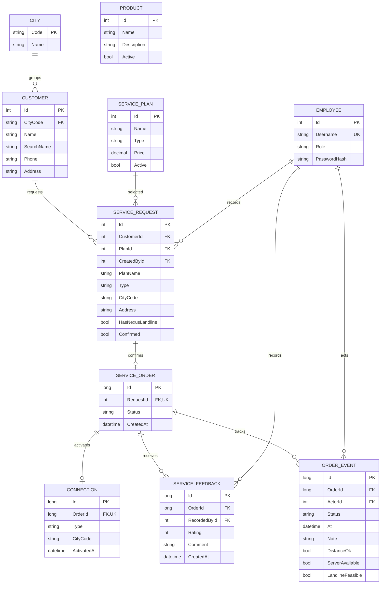

# ERD Nexus Review 1

Mỗi Request có tối đa một Order. Khi Retail xác nhận, hệ thống ghi Order `Pending` và sự kiện đầu tiên trong cùng giao dịch. Technical ghi kết quả `Feasible` hoặc `NotFeasible`. Chỉ đơn `Feasible` được cấp Connection và chuyển thành `Connected`. Mỗi Order có tối đa một Connection. Cấp kết nối và ghi lịch sử trạng thái diễn ra trong cùng giao dịch.

Với Dial-up, khách đã có điện thoại cố định Nexus chỉ cần kiểm tra khả thi Internet. Nếu khách chưa có, Technical kiểm tra thêm đường dây điện thoại. Kết quả không khả thi cần lý do.

`ServiceOrder.Id` và `Connection.Id` là serial sinh từ database. Order ID ghép tiền tố `D`, `B` hoặc `T` với serial 10 chữ số. Account ID ghép cùng tiền tố, mã thành phố 3 chữ số và serial kết nối 12 chữ số. Ví dụ `B0000000001` và `B101000000000001`. Mã thành phố, loại dịch vụ, tên gói và địa chỉ lắp đặt được lưu tại thời điểm tạo Request. Việc sửa thông tin khách hàng hoặc danh mục gói về sau không đổi mã của đơn và kết nối đã tạo.

Thiết bị hiện là danh mục độc lập. Phân bổ thiết bị theo kết nối, tồn kho và mua hàng từ vendor thuộc giai đoạn sau. Phản hồi được ghi theo Order đã kết nối. Quan hệ từ Order qua Request xác định Customer tương ứng.
