# ERD Nexus Review 1, Financial Billing Engine, Inventory Management & Customer Portal

```mermaid
erDiagram
    CITY ||--o{ CUSTOMER : groups
    CITY ||--o{ RETAIL_SHOP : locates
    RETAIL_SHOP ||--o{ EMPLOYEE : employs
    CUSTOMER ||--o| EMPLOYEE : links
    RETAIL_SHOP ||--o{ SERVICE_REQUEST : originates
    RETAIL_SHOP ||--o{ PAYMENT_TRANSACTION : collects_at
    CUSTOMER ||--o{ SERVICE_REQUEST : requests
    SERVICE_PLAN ||--o{ SERVICE_REQUEST : selected
    EMPLOYEE ||--o{ SERVICE_REQUEST : records
    SERVICE_REQUEST ||--o| SERVICE_ORDER : confirms
    SERVICE_ORDER ||--o{ ORDER_EVENT : tracks
    EMPLOYEE ||--o{ ORDER_EVENT : acts
    SERVICE_ORDER ||--o| CONNECTION : activates
    SERVICE_ORDER ||--|| SECURITY_DEPOSIT : secures
    SECURITY_DEPOSIT ||--o{ DEPOSIT_TRANSACTION : records
    EMPLOYEE ||--o{ DEPOSIT_TRANSACTION : confirms
    RETAIL_SHOP ||--o{ DEPOSIT_TRANSACTION : receives_at
    INVOICE ||--o{ DEPOSIT_TRANSACTION : legacy_source
    SERVICE_ORDER ||--|| ADVANCE_ACCOUNT : prepays
    ADVANCE_ACCOUNT ||--o{ ADVANCE_TRANSACTION : records
    EMPLOYEE ||--o{ ADVANCE_TRANSACTION : confirms
    RETAIL_SHOP ||--o{ ADVANCE_TRANSACTION : receives_at
    INVOICE ||--o{ ADVANCE_TRANSACTION : allocated_to
    PAYMENT_TRANSACTION o|--o| ADVANCE_TRANSACTION : allocation_payment
    PRODUCT ||--o{ CONNECTION : equips
    EMPLOYEE ||--o{ CONNECTION : refunds
    CONNECTION ||--o{ INVOICE : bills
    CONNECTION ||--o{ EQUIPMENT_INCIDENT : incurs
    PRODUCT ||--o{ EQUIPMENT_INCIDENT : involves
    EMPLOYEE ||--o{ EQUIPMENT_INCIDENT : records
    INVOICE ||--o{ PAYMENT_TRANSACTION : settles
    EMPLOYEE ||--o{ INVOICE : generates
    EMPLOYEE ||--o{ INVOICE : settles
    EMPLOYEE ||--o{ PAYMENT_TRANSACTION : collects
    SERVICE_ORDER ||--o{ SERVICE_FEEDBACK : receives
    EMPLOYEE ||--o{ SERVICE_FEEDBACK : records

    VENDOR ||--o{ PURCHASE_ORDER : supplies
    PRODUCT ||--o{ PURCHASE_ORDER : purchases
    PURCHASE_ORDER ||--o{ VENDOR_PAYMENT : settles
    VENDOR ||--o{ VENDOR_PAYMENT : receives

    CUSTOMER ||--o{ CUSTOMER_DOCUMENT : owns
    CITY ||--o{ CUSTOMER_DOCUMENT : indexes
    EMPLOYEE ||--o{ CUSTOMER_DOCUMENT : uploads
    CONNECTION ||--o{ PLAN_CHANGE_REQUEST : targets
    SERVICE_PLAN ||--o{ PLAN_CHANGE_REQUEST : upgrades_to
    EMPLOYEE ||--o{ PLAN_CHANGE_REQUEST : requests
    EMPLOYEE ||--o{ PLAN_CHANGE_REQUEST : reviews
    CUSTOMER ||--o{ CUSTOMER_QUERY : submits
    EMPLOYEE ||--o{ CUSTOMER_QUERY : creates
    EMPLOYEE ||--o{ CUSTOMER_QUERY : answers
    EMPLOYEE ||--o{ CUSTOMER_QUERY : closes

    ADVANCE_ACCOUNT {
        long OrderId PK,FK
        decimal PerConnectionAmount "nullable snapshot"
        decimal GrossAmount
        int DiscountPercent
        decimal QuotedAmount
        decimal ReceivedAmount
        decimal AllocatedAmount
        decimal RefundedAmount
        string Origin
        long Version
    }
    ADVANCE_TRANSACTION {
        long Id PK
        long OrderId FK
        string OperationId UK
        string Kind
        decimal Amount
        string Method
        string Reference
        string Note
        datetime At
        int ActorId FK
        int RetailShopId FK
        long InvoiceId FK
        long PaymentId FK,UK
        decimal AvailableAfter
    }
    SECURITY_DEPOSIT {
        long OrderId PK,FK
        decimal GrossAmount
        int DiscountPercent
        decimal RequiredAmount
        decimal CollectedAmount
        decimal RefundedAmount
        bool NeedsReconciliation
        string Origin
        long Version
    }
    DEPOSIT_TRANSACTION {
        long Id PK
        long OrderId FK
        string OperationId UK
        string Kind
        decimal Amount
        string Method
        string Reference
        string Note
        datetime At
        int ActorId FK
        int RetailShopId FK
        long SourceInvoiceId FK
        decimal CollectedAfter
        decimal RefundedAfter
    }
    CITY {
        string Code PK
        string Name
    }
    RETAIL_SHOP {
        int Id PK
        string Code UK
        string Name
        string CityCode FK
        string Address
        string Phone
        bool Active
    }
    CUSTOMER {
        int Id PK
        string CityCode FK
        string Name
        string SearchName
        string Phone
        string Address
        string TaxId
        string Email
        string ContactPerson
        string CustomerType
        string Status
    }
    EMPLOYEE {
        int Id PK
        string Username UK
        string DisplayName
        string Role
        string PasswordHash
        bool Active
        int RetailShopId FK
        int CustomerId FK,UK
    }
    SERVICE_PLAN {
        int Id PK
        string Name
        string Type
        string Description
        decimal Price
        decimal AdvancePerConnection "nullable policy"
        decimal LocalCallRate
        decimal StdCallRate
        decimal MobileMsgRate
        int ValidityMonths
        int HoursAllowance
        int SpeedKbps
        bool Active
    }
    PRODUCT {
        int Id PK
        string Name
        string Description
        bool Active
        int QuantityInStock
        decimal ReplacementPrice
    }
    VENDOR {
        int Id PK
        string Code UK
        string Name
        string ContactPerson
        string Phone
        string Email
        string Address
        bool Active
    }
    PURCHASE_ORDER {
        int Id PK
        string OrderNumber UK
        int VendorId FK
        int ProductId FK
        int Quantity
        decimal UnitPrice
        decimal TotalAmount
        string Status
        datetime OrderedAt
        datetime ReceivedAt
        string Note
    }
    VENDOR_PAYMENT {
        int Id PK
        string PaymentNumber UK
        int PurchaseOrderId FK
        int VendorId FK
        decimal Amount
        datetime PaidAt
        string Method
        string Reference
        string Note
    }
    SERVICE_REQUEST {
        int Id PK
        int CustomerId FK
        int PlanId FK
        int CreatedById FK
        int RetailShopId FK
        string PlanName
        string Type
        string CityCode
        string Address
        bool HasNexusLandline
        decimal SnapshotPrice
        int ConnectionCount
        datetime CreatedAt
        bool Confirmed
    }
    SERVICE_ORDER {
        long Id PK
        int RequestId FK,UK
        string Status
        datetime CreatedAt
    }
    ORDER_EVENT {
        long Id PK
        long OrderId FK
        int ActorId FK
        string Status
        datetime At
        string Note
        bool DistanceOk
        bool ServerAvailable
        bool LandlineFeasible
    }
    CONNECTION {
        long Id PK
        long OrderId FK,UK
        string Type
        string CityCode
        datetime ActivatedAt
        long BillingVersion "invoice issuance concurrency token"
        string Status
        string SuspendReason
        datetime SuspendedAt
        datetime TerminatedAt
        string RefundStatus
        decimal RefundAmount
        datetime RefundedAt
        int RefundedById FK
        string RefundNote
        int AssignedProductId FK
    }
    CUSTOMER_DOCUMENT {
        int Id PK
        int CustomerId FK
        string DocumentType
        string Title
        string FilePathOrUrl
        string OriginalFileName
        string ContentType
        long FileSizeBytes
        int Year
        string CityCode FK
        datetime UploadedAt
        int UploadedById FK
    }
    PLAN_CHANGE_REQUEST {
        int Id PK
        long ConnectionId FK
        int TargetPlanId FK
        int RequestedById FK
        datetime RequestedAt
        string Status
        string Note
        int ReviewedById FK
        datetime ReviewedAt
    }
    CUSTOMER_QUERY {
        int Id PK
        int CustomerId FK
        string Subject
        string Category
        string Question
        string Answer
        string Status
        datetime CreatedAt
        int CreatedById FK
        datetime AnsweredAt
        int AnsweredById FK
        datetime ClosedAt
        int ClosedById FK
        bool IsFaq
    }
    EQUIPMENT_INCIDENT {
        int Id PK
        long ConnectionId FK
        int ProductId FK
        datetime IncidentDate
        string Description
        decimal ReplacementFee
        int RecordedById FK
        bool Settled
    }
    INVOICE {
        long Id PK
        long ConnectionId FK
        string InvoiceNumber UK
        datetime BillingPeriodStart
        datetime BillingPeriodEnd
        decimal RentalAmount
        decimal LocalMinutes
        decimal StdMinutes
        decimal MobileMinutes
        decimal CallUsageAmount
        decimal EquipmentFee
        decimal Subtotal
        decimal DiscountAmount
        int DiscountPercent
        decimal TaxRate
        decimal TaxAmount
        decimal DepositAmount
        decimal PreviousDueBalance
        decimal TotalAmount
        decimal PaidAmount
        decimal DueAmount
        string Status
        datetime CreatedAt
        int CreatedById FK
        datetime PaidAt
        int PaidById FK
    }
    PAYMENT_TRANSACTION {
        long Id PK
        long InvoiceId FK
        decimal Amount
        datetime PaidAt
        int PaidById FK
        int RetailShopId FK
        string Channel
        string Note
        string OperationId UK "nullable for historical and advance payments"
        string RequestFingerprint "nullable request identity"
    }
    SERVICE_FEEDBACK {
        long Id PK
        long OrderId FK
        int RecordedById FK
        int Rating
        string Comment
        datetime CreatedAt
    }
```

## Ràng buộc cơ sở dữ liệu, Concurrency & Vòng đời trạng thái

- **Ràng buộc CHECK & Khóa ngoại:**
  - `CK_Plans_ValidityMonths`: `ValidityMonths IN (1, 3, 6, 12)`.
  - `CK_Orders_Serial`: `Id >= 1 AND Id <= 9999999999` (giữ định dạng Order ID 11 ký tự).
  - `CK_Connections_Serial`: `Id >= 1 AND Id <= 999999999999` (giữ định dạng Account ID 16 ký tự).
  - `CK_Feedback_Rating`: `Rating >= 1 AND Rating <= 5`.
  - Mọi khóa ngoại đều cấu hình `DeleteBehavior.Restrict` để bảo toàn lịch sử kiểm toán (bao gồm `FK_Employees_Customers_CustomerId` trên `Employee.CustomerId`).
- **Chỉ mục (Indexes):**
  - **Unique Indexes:** `Employee.Username`, `Employee.CustomerId` (`IX_Employees_CustomerId` — unique không lọc trên SQLite `DemoDb` do SQLite cho phép nhiều giá trị `NULL`; filtered unique `WHERE [CustomerId] IS NOT NULL` trên SQL Server `SqlServerDb`), `RetailShop.Code`, `Vendor.Code`, `PurchaseOrder.OrderNumber`, `VendorPayment.PaymentNumber`, `Invoice.InvoiceNumber` (`IX_Invoices_InvoiceNumber`), `ServiceOrder.RequestId`, `Connection.OrderId`.
  - **Non-Unique Indexes:** `Customer.Phone` (`IX_Customers_Phone`).
- **Optimistic Concurrency Tokens:** `Product.QuantityInStock`, `PurchaseOrder.Status`, `ServiceRequest.Confirmed`, `ServiceOrder.Status`, `Connection.Status`, `Invoice.Status`, `Invoice.PaidAt`, `Invoice.PaidAmount`, `Invoice.DueAmount`, `SecurityDeposit.Version`, `AdvanceAccount.Version`.
- **Vai trò, liên kết tài khoản & thuộc tính tính toán (Ignored Properties):**
  - `Employee.Role`: nhận 5 giá trị `Admin | Retail | Technical | Billing | Customer` (`Roles.Staff` gồm 4 vai trò nhân viên; `Roles.Customer = "Customer"` dành cho cổng tự phục vụ). Tài khoản `Customer` liên kết 1–0..1 tới `Customer` qua `Employee.CustomerId` (bắt buộc không rỗng với `Customer`, `NULL` với nhân viên). `POST /api/employees` chỉ tạo nhân viên thuộc `Roles.Staff`; `PUT /api/employees/{id}` khóa bất biến `Role = "Customer"` và cấm gán `RetailShopId` cho tài khoản `Customer`.
  - `Customer.Status`: nhận `ACTIVE | SUSPENDED` (mặc định `"ACTIVE"` khi tự đăng ký `/api/register` hoặc tạo hồ sơ mới).
  - **Thuộc tính tính toán không lưu cột DB (`.Ignore()` trong `PropertyConfiguration.cs`):** `Customer.IsSuspended` (`Status == "SUSPENDED"`), `Customer.Code` (`CUS-{Id:D6}`), `ServiceOrder.Code` (`[D|B|T]{Id:D10}`), `Connection.AccountId` (`{Type}{CityCode}{Id:D12}`). Lưu ý `ServiceOrder.Status` được lưu dạng số nguyên (`OrderStatus` enum) trong DB.
  - **Chặn tạm ngưng & vô hiệu hóa:** Khi `Customer.Status == "SUSPENDED"` hoặc `Employee.Active == false`, `POST /api/login` từ chối đăng nhập (`403 Forbidden`), và `/api/customer/*` chặn mọi thao tác ghi (`PUT`/`POST`) với `403 Forbidden` (riêng `Employee.Active == false` chặn cả đọc `GET` với `403`).
- **Vòng đời đơn hàng, kết nối & kênh thanh toán:**
  - `ServiceOrder.Status`: `Pending` → `Feasible` / `NotFeasible` → `Connected`.
  - `Connection.Status`: `Active` ↔ `TemporarilyInactive` → `PermanentlyInactive` (khi chấm dứt, tính `RefundAmount` và đặt `RefundStatus = Pending` hoặc `None`; bộ phận Billing giải ngân sang `Refunded`).
  - `Invoice.Status`: `Unpaid` / `PartiallyPaid` → `Paid` hoặc chuyển sang `RolledOver` (`DueAmount = 0`) khi phát hành hóa đơn chu kỳ tiếp theo.
  - `PaymentTransaction.Channel`: `CityOffice | RetailOutlet | CustomerPortal | Advance` (`CustomerPortal` dùng cho thanh toán trực tuyến; `Advance` là phân bổ tiền thực nhận trước đó, không phải receipt tiền mới).

**Cọc tách khỏi hóa đơn mới:** `SecurityDeposit` chốt nghĩa vụ cọc sau ưu đãi theo `ServiceRequest.ConnectionCount` tại lúc xác nhận Order. `CollectedAmount - RefundedAmount` là tiền thực giữ; chỉ số dư đã xác minh được hoàn sau đóng dịch vụ, không cấn trừ nợ/phí hỏng. `Version` là concurrency token; ghi tiền đồng thời kiểm tra trạng thái Order/Connection. `DepositTransaction.OperationId` unique toàn hệ thống, bộ `(OrderId, Kind, Reference)` cũng unique. Reconciliation lưu tổng có chứng từ, không tạo giao dịch tiền lần nữa. Có FK nguồn hóa đơn cho phân bổ legacy.

`Invoice.DepositAmount`, `DiscountAmount`, `DiscountPercent` bằng 0 trên hóa đơn cước mới. Các bill lịch sử giữ nguyên số tiền và payment. Startup backfill chỉ nhập cọc đã thu từ đúng một bill chứa cọc Paid có đủ lịch sử thanh toán khớp; trường hợp còn lại là `NeedsReconciliation`. [Luồng nghiệp vụ và test chi tiết](deposit-flow.md).

## Lịch sử Migration (EF Core)

**Payment history là phép đọc dữ liệu đã lưu:** gom `Invoice.Payments` của tất cả bill cùng Connection/Account, giữ FK InvoiceId và payment ID. Tải PaidBy và RetailShop theo FK payment, không lấy outlet hiện tại của nhân viên để thay dữ liệu cũ. ReceiptCode nội bộ suy ra từ ID, `paymentHistoryGaps` suy ra khi PaidAmount lệch tổng Payments; cả hai không tạo bảng hoặc tự thêm payment. [Luồng kiểm tra](payment-history-flow.md).

**Advance tách riêng:** `AdvanceAccount` chốt policy gói nullable và mức bulk tại xác nhận Order; số dư = Received − Allocated − Refunded. `AdvanceTransaction.Kind` là Collection/Allocation/Refund. OperationId unique toàn hệ thống, `(OrderId, Kind, Reference)` unique, PaymentId nullable unique; chỉ allocation liên kết payment kênh Advance và Invoice của chính Account. Ledger/payment/bill lưu nguyên tử; concurrency số tiền bill chặn cả tranh chấp khi trạng thái vẫn PartiallyPaid. Startup backfill Legacy rỗng, không suy luận credit từ cọc/payment cũ. [Luồng và kiểm thử](advance-flow.md).

Hệ thống duy trì song song hai bộ migration đồng bộ cho SQLite (`DemoDb` tại `Migrations/Demo/`) và SQL Server (`SqlServerDb` tại `Migrations/SqlServer/`):

| # | `DemoDb` (SQLite) | `SqlServerDb` (SQL Server) | Nội dung chính |
| --- | --- | --- | --- |
| 1 | `20261111053812_InitialDemo` | `20261111053815_InitialSqlServer` | Các bảng cốt lõi (`Cities`, `Customers`, `Employees`, `Plans`, `Products`, `Requests`, `Orders`, `OrderEvents`, `Connections`, `Invoices`, `Payments`, `Feedback`) |
| 2 | `20261113120859_Review1CustomerProfile` | `20261113120912_Review1CustomerProfile` | Bổ sung thông tin hồ sơ khách hàng (`TaxId`, `Email`, `ContactPerson`, `CustomerType`, `Status`) |
| 3 | `20261116023312_Review1Billing` | `20261116023315_Review1Billing` | Cập nhật cấu trúc bảng thanh toán/cước Review 1 |
| 4 | `20261120094836_FinancialBilling` | `20261120094849_FinancialBilling` | Financial Billing Engine (`Invoice` breakdown, `PaymentTransaction.Channel`, `RetailShops`) |
| 5 | `20261120125105_EquipmentAndInventory` | `20261120125129_EquipmentAndInventory` | `Vendors`, `PurchaseOrders`, `VendorPayments`, `EquipmentIncidents`, `Products.QuantityInStock`/`ReplacementPrice`, `Connections.AssignedProductId` |
| 6 | `20261120145810_LifecycleAndCustomerSupport` | `20261120145824_LifecycleAndCustomerSupport` | Cột vòng đời/hoàn cọc trên `Connections`, `CustomerDocuments`, `PlanChangeRequests`, `CustomerQueries` |
| 7 | `20261120184852_AddDocumentFileMetadata` | `20261120184910_AddDocumentFileMetadata` | Metadata tệp chứng từ (`OriginalFileName`, `ContentType`, `FileSizeBytes`) trên `CustomerDocuments` |
| 8 | `20261120210841_RemediationSchemaUpdates` | `20261120210849_RemediationSchemaUpdates` | `Employees.Active`/`RetailShopId`, `Plans.ValidityMonths`/`HoursAllowance`/`SpeedKbps` + `CK_Plans_ValidityMonths`, `Requests.RetailShopId`, `Payments.RetailShopId`, `Invoices.CreatedById`, `IX_Invoices_InvoiceNumber`, `Connections.RefundNote`/`RefundedAt`/`RefundedById`, `PlanChangeRequests.RequestedById`, `CustomerQueries.CreatedById`/`ClosedAt`/`ClosedById` |
| 9 | `20261121083859_AddEmployeeCustomerLink` | `20261121083905_AddEmployeeCustomerLink` | `Employees.CustomerId` (`int?`), `IX_Employees_CustomerId` (unique không lọc ở SQLite; filtered unique `[CustomerId] IS NOT NULL` ở SQL Server), `FK_Employees_Customers_CustomerId` (`ReferentialAction.Restrict`) |
| 10 | `20261125071106_OrderDepositLedger` | `20261125071141_OrderDepositLedger` | Thêm `SecurityDeposits`, `DepositTransactions`, FK, unique OperationId và biên nhận theo Order; backfill bằng chứng legacy chạy khi API khởi động |
| 11 | `20261125085837_OrderAdvanceCredit` | `20261125090026_OrderAdvanceCredit` | `Plans.AdvancePerConnection` nullable; `AdvanceAccounts` và `AdvanceTransactions`, snapshot, số dư, FK bill/payment, unique operation/chứng từ/payment; startup tạo sổ Legacy rỗng |
